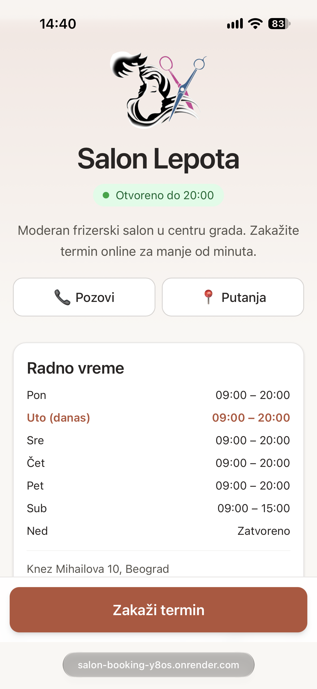
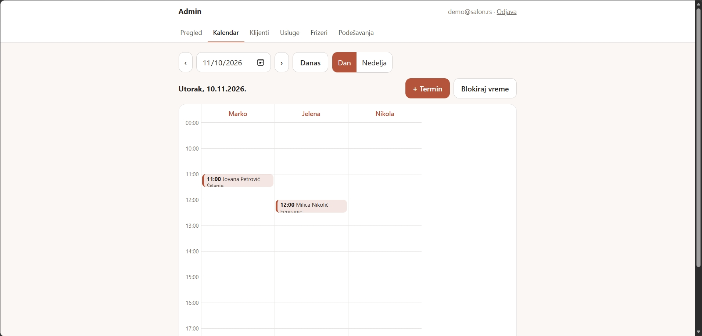

# Salon Booking

Online appointment booking for a local hair salon. Mobile-first, in Serbian, no account needed for clients.

**Live demo:** <https://salon-booking-y8os.onrender.com> (free hosting: the first load can take ~30 s)
**Admin demo:** `/admin` — `demo@salon.rs` / `demo1234`




## Features
**Clients**
- 5-step booking wizard: services (multi-select, auto totals) → stylist (or "any available") → date/time → details → confirmation
- Availability computed from working hours, breaks, time off, holidays, existing bookings and per-service time steps (15/30/60 min)
- Manage a booking via a secure link: cancel or reschedule within a configurable deadline
- Find a booking by phone + 6-digit code, `.ics` calendar export, email confirmations and 24 h reminders

**Admin**
- Dashboard, day/week calendar per stylist, manual bookings, blocked time, statuses (done / no-show)
- CRUD for categories, services, stylists (per-stylist prices and hours), clients with notes and history
- Salon settings, email templates, image upload (resized in the browser)

## Tech
React, Vite, TypeScript, Tailwind CSS · Node.js, Express, Zod · Prisma, PostgreSQL · JWT (httpOnly cookie) · Resend · date-fns-tz

## Interesting problems
- **Double-booking:** availability is re-checked inside a `Serializable` transaction, with retry on serialization conflicts (`P2034`).
- **Slot calculation:** the intersection of salon hours and stylist hours, minus breaks, time off, holidays and booked intervals, stepped by the largest step among selected services.
- **Time zones / DST:** the database stores UTC, working hours are minutes from local midnight, and conversion goes through `Europe/Belgrade` so 09:00 stays 09:00 across DST changes.
- **Abuse protection:** rate limiting, a honeypot field, and brute-force protection on the booking-code lookup.

## Run locally
```bash
cd server && cp .env.example .env   # set DATABASE_URL (PostgreSQL) and JWT_SECRET
npm i && npx prisma migrate dev && npm run seed && npm run dev
cd ../client && npm i && npm run dev
```
Open http://localhost:5173

## Out of scope (architecture is ready for it)
Online payments, loyalty programs, multiple locations, SMS reminders.